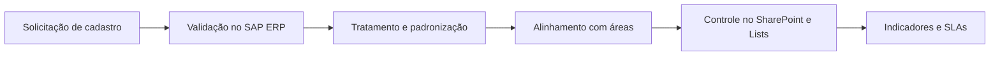

<h1 align="center">Olá, eu sou a Isabelly Lohanne 👋</h1>

  

  
  
  

---

## 👩‍💻 Sobre mim

- 🎓 Graduanda em **Tecnologia em Banco de Dados** na UNINOVE (2025–2027)
- 💼 Experiência em **Gestão e Qualidade de Dados (Master Data)** na **Atlas Copco** e em **Dados e Operações** no **Bradesco Private Bank**
- 🔍 Trabalho com **validação, tratamento e padronização de dados** no **SAP ERP**, controles em **Excel** e acompanhamento de **indicadores e SLAs**
- 🌱 Estudando **SQL, Python e Power BI** para evoluir da qualidade de dados para a análise
- 🤖 Interesse em **automação e IA** para ganho de eficiência em processos
- 🎯 **Busco:** posição **Júnior** em Dados, Qualidade de Dados e Data Operations

---

## 🧰 Stack

**✅ Uso profissional**

**📘 Conhecimento**

  

**🌱 Em desenvolvimento**

> Python e Power BI em nível básico. Estou construindo projetos práticos para consolidar.

---

## 🔄 Como eu trabalho com qualidade de dados

Fluxo que vivencio no dia a dia de Master Data, do pedido ao acompanhamento:

**O que verifico em um cadastro:** tipo de item · organização de vendas · NCM · part number · preço e moeda

**Áreas com quem alinho:** Supply Chain · Comércio Exterior · Compras · Fiscal · Logística · Controladoria

---

## 💼 Experiência

### Estagiária de Master Data, Gestão e Qualidade de Dados · Atlas Copco
*out/2025 – out/2026*
- Analisei e validei solicitações de cadastro de **materiais e fornecedores** no SAP ERP, conferindo informações comerciais e fiscais
- Realizei **tratamento, saneamento e padronização** de dados e identifiquei inconsistências, apoiando o diagnóstico de desvios nos processos
- Controlei solicitações e fluxos com **SharePoint e Microsoft Lists**
- Usei **Excel** para controles e análises e acompanhei **indicadores e SLAs**
- Atuei em interface com Supply Chain, Comércio Exterior, Compras, Fiscal, Logística e Controladoria

### Jovem Aprendiz, Dados e Operações · Bradesco Private Bank
*fev/2024 – set/2025*
- Realizei **controles financeiros de cartões corporativos**, conferindo informações e valores
- Organizei processos administrativos e documentais de uma grande instituição financeira
- Elaborei **relatórios e apresentações** em Excel e Microsoft 365, utilizando também SharePoint

---

## 🎓 Formação e cursos

| | |
|---|---|
| 🎓 **Tecnologia em Banco de Dados**, UNINOVE | 2025 – 2027 (cursando) |
| 📗 **Excel**, SENAI | Concluído |
| 🤖 **IA Generativa / Copilot** | Concluído |
| 🌱 **SQL, Python e Power BI** | Em desenvolvimento |
| 🌐 **HTML e CSS**, Alura | Projetos práticos (veja abaixo) |

---

## 🚀 Projetos

| Projeto | Descrição | Tecnologias |
|---|---|---|
| [Desafio-Alura](https://github.com/IsabellyLohanne/Desafio-Alura) | Projeto desenvolvido em curso da Alura. Aplicação de sorteio de amigo secreto desenvolvida em desafio da Alura: o usuário adiciona nomes a uma lista e sorteia um participante. | HTML · CSS |
| [Projeto-N-mero-Secreto](https://github.com/IsabellyLohanne/Projeto-N-mero-Secreto) | Projeto desenvolvido em curso da Alura: Jogo do número secreto desenvolvido em desafio da Alura: o sistema sorteia um número e o usuário tenta adivinhar, recebendo dicas se o chute é maior ou menor.| HTML · CSS |

### 🛠️ Roadmap (planejado, ainda não concluído)

- [ ] Limpeza e padronização de uma base pública (Excel ou Python)
- [ ] Consultas SQL respondendo perguntas de negócio
- [ ] Dashboard em Power BI com indicadores e SLA
- [ ] Automação simples de um processo repetitivo

---

## 📊 Atividade no GitHub

  
  

  

  

---

## 🔭 Interesses

Qualidade de dados · Indicadores e processos · Banco de Dados e SQL · Business Intelligence · Automação e IA aplicada a dados

  <i>Aprendendo em público, um projeto de cada vez. Vamos conversar? 💬</i>

